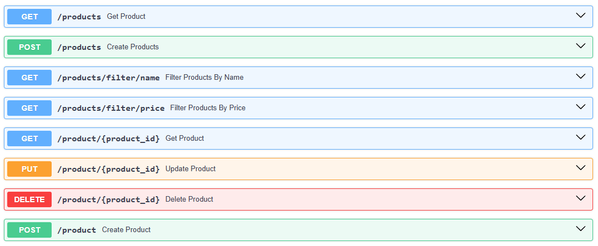

# API de productos, carritos y ventas

API REST desarrollada con [FastAPI](https://fastapi.tiangolo.com/) para el
Laboratorio de Python de la UNLa. Utiliza SQLite como base de datos y
SQLAlchemy como ORM.

La aplicación administra:

- productos;
- carritos y los productos incluidos en cada carrito;
- ventas asociadas a un carrito;
- clientes asociados a una venta.

## Requisitos

- Python 3.10 o superior.

## Instalación

Desde la carpeta raíz del proyecto, crear y activar un entorno virtual:

```powershell
python -m venv .venv
.\.venv\Scripts\Activate.ps1
```

Instalar las dependencias:

```powershell
python -m pip install -r requirements.txt
```

## Ejecución

Para iniciar la API en modo desarrollo:

```powershell
uvicorn app:app --reload
```

La API queda disponible en `http://127.0.0.1:8000`.

La base de datos SQLite se encuentra en `database.db`. Al importar
`database.py`, SQLAlchemy crea las tablas que todavía no existan.

Para iniciar la API indicando host y puerto explícitamente:

```powershell
python -m uvicorn app:app --host 0.0.0.0 --port 8000
```

### Documentación interactiva

FastAPI genera automáticamente:

- Swagger UI: `http://127.0.0.1:8000/docs`
- ReDoc: `http://127.0.0.1:8000/redoc`

También existe un endpoint de bienvenida:

```http
GET /
```

Respuesta:

```json
{
  "message": "Hello World"
}
```

## Modelo de datos

| Entidad | Campos principales |
| --- | --- |
| Producto | `id`, `name`, `price` |
| Carrito | `id`, `date`, `state` |
| Producto del carrito | `id`, `cart_id`, `product_id`, `quantity` |
| Venta | `id`, `date`, `time`, `cart_id`, `client_id` |
| Cliente | `id`, `name`, `email`, `phone` |

Los estados válidos para un carrito son `abierto` y `cerrado`. Al registrar
una venta, el carrito se cierra y el total de la venta se calcula sumando
`price * quantity` de sus productos; el total no se almacena en la tabla
`sales`.

## Endpoints

### Productos



| Método | Ruta | Descripción |
| --- | --- | --- |
| `GET` | `/products` | Lista todos los productos. |
| `GET` | `/products/filter/name` | Filtra productos por nombre, con paginación. |
| `GET` | `/products/filter/price` | Filtra productos por rango de precio, con paginación. |
| `GET` | `/product/{product_id}` | Obtiene un producto por ID. |
| `POST` | `/product` | Crea un producto. |
| `POST` | `/products` | Crea varios productos. |
| `PUT` | `/product/{product_id}` | Actualiza un producto. |
| `DELETE` | `/product/{product_id}` | Elimina un producto que no esté en un carrito. |

Crear un producto:

```http
POST /product
Content-Type: application/json
```

```json
{
  "name": "Teclado",
  "price": 8000
}
```

Crear varios productos requiere un arreglo JSON:

```json
[
  {
    "name": "Teclado",
    "price": 8000
  },
  {
    "name": "Mouse",
    "price": 4500
  }
]
```

Filtros de productos:

```text
GET /products/filter/name?name=mouse&page=1&limit=10
GET /products/filter/price?min_price=1000&max_price=10000&page=1&limit=10
```

Los filtros devuelven `page`, `limit`, `total_results` y `products`.

### Ventas

| Método | Ruta | Descripción |
| --- | --- | --- |
| `GET` | `/sales` | Lista todas las ventas. |
| `GET` | `/sales/filter/date` | Filtra ventas por fecha inicial y/o final, con paginación. |
| `GET` | `/sales/{sale_id}` | Obtiene una venta por ID. |
| `POST` | `/sale` | Registra una venta y cierra su carrito. |
| `POST` | `/sales/{sale_id}/cart` | Asocia un carrito a una venta existente. |
| `PUT` | `/sales/{sale_id}` | Actualiza una venta. |
| `DELETE` | `/sale/{sale_id}` | Elimina una venta. |

Registrar una venta:

```http
POST /sale
Content-Type: application/json
```

```json
{
  "date": "2026-10-30",
  "time": "12:45",
  "cart_id": 10,
  "client_id": 1
}
```

La respuesta incluye el total calculado:

```json
{
  "id": 1,
  "date": "2026-10-30",
  "time": "12:45:00",
  "cart_id": 10,
  "client_id": 1,
  "total_price": 12500
}
```

El carrito indicado debe existir, estar abierto y no estar asociado a otra
venta. El cliente indicado debe existir. El campo `client_id` forma parte del
cuerpo requerido por el esquema actual.

Filtro de ventas por fecha:

```text
GET /sales/filter/date?date_start=2026-01-01&date_finish=2026-12-31&page=1&limit=5
```

Los parámetros `date_start` y `date_finish` son opcionales. La respuesta
incluye `page`, `limit`, `total_results` y `sales`.

### Carritos

| Método | Ruta | Descripción |
| --- | --- | --- |
| `GET` | `/carts` | Lista todos los carritos. |
| `GET` | `/cart/{cart_id}` | Obtiene un carrito por ID. |
| `POST` | `/cart` | Crea un carrito. |
| `PUT` | `/cart/{cart_id}` | Actualiza un carrito no asociado a una venta. |
| `DELETE` | `/cart/{cart_id}` | Elimina un carrito no asociado a una venta. |
| `POST` | `/cart/{cart_id}/product` | Agrega unidades de un producto al carrito. |
| `DELETE` | `/cart/{cart_id}/products/{product_id}` | Quita un producto del carrito. |

Crear un carrito:

```json
{
  "date": "2026-10-30",
  "state": "abierto"
}
```

Agregar un producto:

```json
{
  "product_id": 3,
  "quantity": 2
}
```

Solo se pueden agregar o quitar productos de carritos abiertos. La cantidad
debe ser mayor que cero.

### Productos de carritos

Estos endpoints permiten consultar y administrar directamente los registros
de la tabla intermedia `cart_product`:

| Método | Ruta | Descripción |
| --- | --- | --- |
| `GET` | `/carts_products` | Lista las relaciones carrito-producto. |
| `GET` | `/cart_products/{cart_product_id}` | Obtiene una relación por ID. |
| `POST` | `/cart_products` | Crea una relación carrito-producto. |
| `PUT` | `/cart_products/{cart_product_id}` | Actualiza una relación. |
| `DELETE` | `/cart_products/{cart_product_id}` | Elimina una relación. |

El cuerpo de una relación es:

```json
{
  "cart_id": 10,
  "product_id": 3,
  "quantity": 2
}
```

Para la operación habitual de agregar productos se recomienda usar
`POST /cart/{cart_id}/product`, ya que valida el estado del carrito, la
existencia del producto y la cantidad.

### Clientes

| Método | Ruta | Descripción |
| --- | --- | --- |
| `GET` | `/clients` | Lista todos los clientes. |
| `GET` | `/client/{client_id}` | Obtiene un cliente por ID. |
| `POST` | `/client` | Crea un cliente. |
| `PUT` | `/client/{client_id}` | Actualiza un cliente. |
| `DELETE` | `/client/{client_id}` | Elimina un cliente. |

Crear un cliente:

```json
{
  "name": "Ana Pérez",
  "email": "ana@example.com",
  "phone": "11-5555-5555"
}
```

El correo electrónico debe ser único.

## Flujo recomendado

1. Crear los productos con `POST /product` o `POST /products`.
2. Crear un carrito abierto con `POST /cart`.
3. Agregar productos con `POST /cart/{cart_id}/product`.
4. Crear el cliente con `POST /client`.
5. Registrar la venta con `POST /sale`. Esto cierra el carrito.

Una vez asociado a una venta, un carrito no puede modificarse ni eliminarse.

## Formato de fechas y horas

- Las fechas usan el formato ISO `YYYY-MM-DD`, por ejemplo `2026-10-30`.
- Las horas usan el formato `HH:MM` o `HH:MM:SS`, por ejemplo `12:45`.
- Los precios se expresan como números, sin símbolo de moneda.

## Respuestas y errores

La API utiliza, entre otros, los siguientes códigos HTTP:

- `200 OK`: operación exitosa.
- `201 Created`: recurso creado correctamente.
- `400 Bad Request`: operación inválida según el estado o las reglas del recurso.
- `404 Not Found`: recurso inexistente o colección sin registros.
- `409 Conflict`: conflicto con un recurso existente, por ejemplo, un producto
  duplicado o un carrito ya asociado a una venta.
- `500 Internal Server Error`: error inesperado del servidor.

Los detalles del error se devuelven en el campo `detail` de la respuesta JSON.
